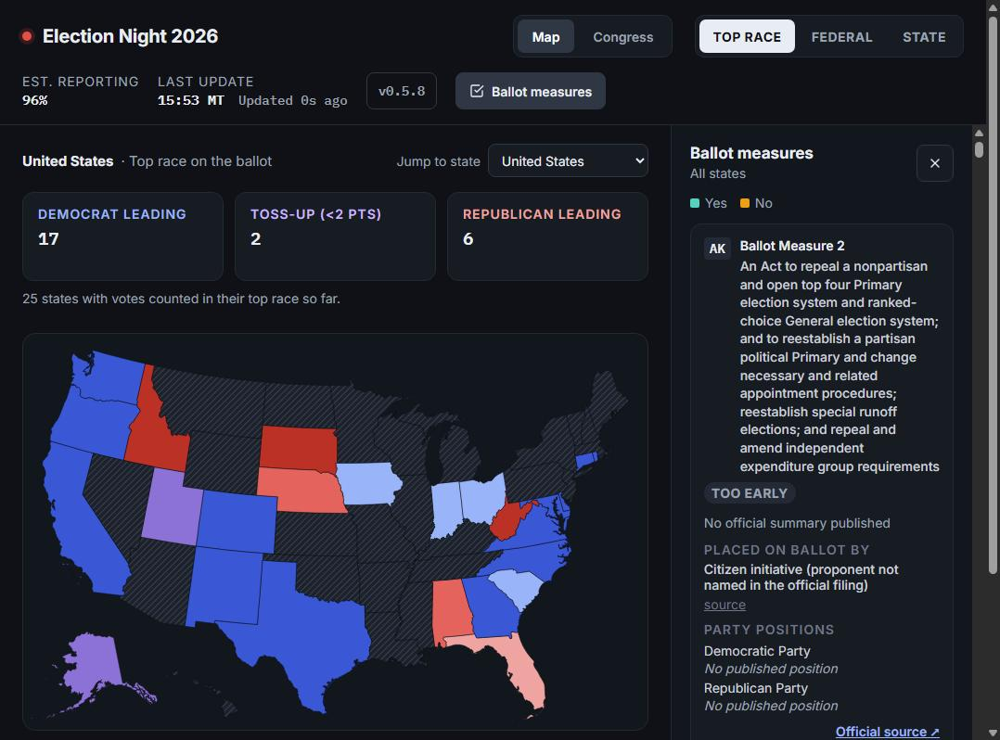

# election-map

A live, public results map for the 2026 US midterms, built from official state election feeds. No paywall, no login.

**Live:** https://election.jamiecahn.com

Built by Jamie Cahn · https://jamiecahn.com



*Unofficial results — counts change as ballots are reported. This app never calls races: "leading" means most
votes counted right now.*

## What it does

- **National map, three ways:** *Top race* colours each state by its highest-office contest (Senate, else Governor,
  else the statewide House popular vote); *Federal* shows U.S. Senate or House; *State* shows Governor and every
  other statewide office the feeds carry. Shading is the leader's party, lighter for narrower margins, purple under
  2 points.
- **Drill into a state:** hover for votes counted per party, click for counties shaded (where the source publishes
  counties) and an *All races* tab with every contest in the state's feeds, grouped and searchable.
- **Congress view:** balance of power per chamber, from seats not up this year plus the seats each party currently
  leads.
- **Ballot measures:** a sidebar of statewide measures with yes / no / % yes / % reporting and official measure text,
  each with its source link.
- **Live updates:** new numbers are pushed to open browsers as soon as a source publishes them.
- **Honest gaps:** every state links to its official results page, every number names its source and update time,
  and a state with no live feed says why instead of showing a blank.

## Why I built it

I built this live election-results map on 2026 midterm night. The goal is free, open results data for people in
America, with no paywall and no login, because a lot of people distrust results data from news sources.

## How it works

1. **Polling.** The server polls each official source (state Secretary of State / election-office feeds) every 60
   seconds by default, with a polite User-Agent and conditional requests, and backs off on errors (up to 10
   minutes). A source that blocks automated clients is never worked around; it goes on the
   [source roadmap](docs/source-roadmap.md) instead.
2. **Normalization.** One adapter per source (`server/src/adapters/`) turns that feed's format into a common shape:
   contests classified by office and level, party labels normalized, counties matched to FIPS codes. Anything it
   can't map is logged, never silently dropped.
3. **Storage.** Each new version of a feed is saved as a new snapshot in SQLite. Results are append-only; the API
   serves the latest snapshot.
4. **Push to the browser.** When new numbers land, Socket.io tells every open page to refetch. API responses are
   cached in memory until the next new snapshot and sent with a 15-second cache header, so traffic spikes don't
   hit the database.
5. **Map.** The React client draws pre-projected US state and county shapes with d3-geo and shades them with one
   pure function (`client/src/shading.js`).

Unofficial results; we never call races. Clarity feeds' own winner flags are deliberately ignored.

## Run it locally

**Prerequisites:** Node.js 22 or newer (`server/src/http.js` needs Node ≥ 22.19) and npm. `better-sqlite3` and
`sharp` use prebuilt binaries on common platforms; otherwise they need a C/C++ toolchain and Python to compile.

Clone the repo, then from its root:

```sh
npm install        # installs the root, server/ and client/ (postinstall)
npm run dev        # API on :3710 (watch mode) + Vite on :5173, open http://localhost:5173
```

The server starts polling every configured source right away and creates its SQLite database at
`./data/election-map.db`. The first numbers appear within a minute or so.

Production-style:

```sh
npm run build      # validates CHANGELOG.json, then builds the client into client/dist
npm start          # serves the API and the built client, open http://localhost:3710
```

Tests:

```sh
npm --prefix server test
npm --prefix client test
```

Environment variables (all optional):

| Variable | Default | What it does |
|---|---|---|
| `PORT` | `3710` | Port the server listens on |
| `DATA_DIR` | `./data` | Where the SQLite database (and the photo cache) live |
| `POLL_INTERVAL_SECONDS` | `60` | How often each source is polled (minimum 15) |
| `LOG_LEVEL` | `info` | `debug`, `info`, `warn` or `error` |
| `API_RATE_PER_MINUTE` | `300` | Per-IP rate limit for `/api/*` |
| `CONFIG_DIR` | `./config` | Where source and election config is read from |

## Deploy

It runs as one Docker container (multi-stage build: client built, server and config copied into a
`node:22` slim image).

```sh
cp .env.example .env           # set the bind address, port and container user
mkdir -p data                  # owned by PUID:PGID from .env
docker compose up -d --build
```

| `.env` setting | Default | What it does |
|---|---|---|
| `ELECTION_MAP_BIND_IP` | `127.0.0.1` | Host address the port is published on. Never `0.0.0.0`; use a LAN address only if a proxy on another machine forwards to it. |
| `ELECTION_MAP_PORT` | `3710` | Host port (the container always listens on 3710) |
| `PUID` / `PGID` | `1000` / `1000` | Container user; must own `./data` |
| `POLL_INTERVAL_SECONDS`, `LOG_LEVEL` | `60`, `info` | As above |

Health check: `GET /api/health` answers `"ok": true`. Put a reverse proxy or tunnel with TLS in front for public
traffic; the app trusts `X-Forwarded-For` only from loopback, link-local and private addresses.

`.gitea/workflows/deploy.yml` redeploys on every push to `main` for a Gitea Actions runner that can reach the host's
Docker daemon. It reads its host-specific settings from repository Actions variables (`DEPLOY_DIR`,
`INTERNAL_GIT_URL`, `ELECTION_MAP_BIND_IP`) and fails before touching anything if one is missing.

## Add a state

**If the state (or a county) uses Clarity / Civix ENR:** no code. Find the election id at
`https://results.enr.clarityelections.com/{ST}/elections.json` (or `/{ST}/{County}/elections.json`) and add an
entry to `config/sources/clarity.json`:

```json
{ "state": "XX", "path": "XX", "eid": "123456", "scope": "state", "name": "Xxx 2026 General" }
```

**Otherwise:** add one file, `server/src/adapters/<id>.js`, exporting
`{ id, name, targets(), fetch(target, ctx) }`. The contract is at the top of `server/src/adapters/index.js`:
`targets()` reads `config/sources/<id>.json`; `fetch()` returns normalized races (office, district, choices with
party, per-unit votes or yes/no, precinct reporting). Use `ctx.http` (polite UA, conditional requests) and
`ctx.unmatched()` for anything you can't map. Use `classifyContest`/`normalizeParty` from `server/src/normalize.js`
and `matchCounty` from `server/src/geo.js`. No other file needs to change: the registry picks it up, and the API,
coverage and map follow.

**In the same change**, set the state to `"live"` in `config/coverage-status.json` (`server/test/coverage-status.test.js`
fails otherwise). `docs/source-roadmap.md` lists what each uncovered state publishes.

## Tech stack

- **Server:** Node.js 22, Express 4, Socket.io 4, SQLite via better-sqlite3 12, fast-xml-parser, fflate, sharp
- **Client:** React 18, Vite 5, d3-geo 3, topojson-client, us-atlas (pre-projected state and county shapes)
- **Ops:** one multi-stage Docker image, Docker Compose, Gitea Actions

## Project structure

```
server/src/            Express API, Socket.io, poller, normalization, SQLite snapshot writer
server/src/adapters/   one file per official results source (the registry loads every file)
server/test/           node:test suites, with recorded feed samples in fixtures/
client/src/            React app: map, state view, Congress view, measures sidebar, shading and seat math
config/                which sources to poll, coverage status, official result links, measures, chambers
docs/                  data contract, source roadmap, measure and photo data notes, screenshot
design/                the design exports the client was ported from
scripts/               dev launcher, changelog check, review-sheet generators
```

## FAQ

**Where do the numbers come from?**
Only from free, official public feeds published by state election offices (and some county election sites). No paid
APIs, no API keys, no news organizations. Each state links to its official results page.

**How often does it update?**
Each source is polled every 60 seconds by default. When a source publishes a new version, open pages are told to
refetch within seconds.

**Why does my state show "No live results here"?**
Of 50 states plus DC, 29 have a live statewide source today. Others block automated clients (11), publish no
election-night feed (9), or are planned (2). The page says which, next to the state's official results link.
Details per state: [docs/source-roadmap.md](docs/source-roadmap.md).

**Why is there no county map for some states?**
Some official feeds publish only statewide totals. When that happens the state view says so in words instead of
drawing an empty map.

**Does it call races or project winners?**
No. "Leading" means most votes counted right now. The app never shows or stores "winner", "projected" or "called",
and ignores the winner flags Clarity feeds publish.

**What does purple mean?**
The leader's margin is under 2 points. Grey means no race for that office; hatched grey means no live source.

**Can I self-host it?**
Yes, with Docker (see [Deploy](#deploy)) or Node directly. Note the license below.

## Roadmap

- **Archived races:** the server already keeps every election's snapshots and every API read takes `?election=`
  (`config/elections.json`); a way to pick past elections in the UI is still to come.
- **All 50 states for the 2028 presidential election**, working through the blocked, no-feed and planned states in
  [docs/source-roadmap.md](docs/source-roadmap.md).

## Built with AI

Built with Claude Code from written specs.

## License

No license file yet.
